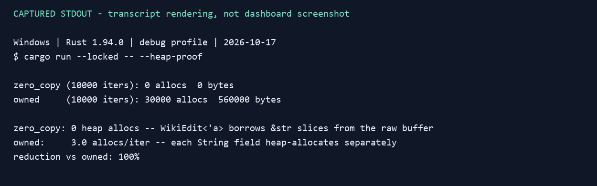
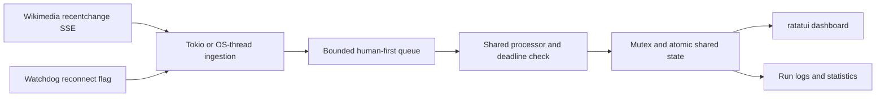

# Wikipedia Real-Time Edit Monitor

A Rust coursework system that measures scheduling delay while processing Wikipedia edits. It offers Tokio tasks and OS-thread pipelines, a human-first bounded queue, overload handling and a terminal dashboard. The project explores **soft real-time behavior**; the 2 ms target is measured rather than guaranteed.

**Current status:** the source includes offline tests, a reproducible allocation demonstration and Criterion benchmarks. The live SSE dashboard requires network access and an interactive terminal; it was not run during this verification. See [verification results](docs/VERIFICATION.md) for the exact scope.



*Rendering of stdout captured from the real offline `--heap-proof` run on 17 October 2026. This is a transcript rendering, not a dashboard screenshot. [Text output](docs/assets/heap-proof.txt).*

## Design and behavior

- Filter the Wikimedia `recentchange` SSE stream to edit events, then classify human and bot activity.
- Keep at most 100 queued edits, prioritize humans and evict the oldest bot on overflow when available.
- Measure queue wait, execution and total elapsed time; mark the 2 ms total deadline as met or missed.
- Enter degraded mode above 50% misses in a 20-result window, skip bots, and recover below 20%.
- Track top wiki domains, reconnect flags and run logs; compare borrowed and owned JSON parsing.



The library contains the shared queue, processing, metrics and state logic; `src/main.rs` selects the pipeline or standalone utilities. [Architecture and timing definitions](docs/PROJECT_GUIDE.md#architecture).

## Run and verify

Use a current stable Rust toolchain with Cargo, from the repository root. Verification used Rust/Cargo 1.94.0 on Windows.

```powershell
cargo test --locked
cargo run --locked -- --heap-proof
```

The allocation demonstration parses the same built-in unescaped fictional edit 10,000 times per representation. Its allocation counts describe that input and parser path; they do not measure whole-pipeline allocations or live latency.

For the live dashboard, use a real terminal with internet access and press `q` to quit:

```powershell
cargo run --release --locked -- --async
cargo run --release --locked -- --threaded
```

Run logs go to `logs/`. `--capture 500` replaces `test_data/events.jsonl` with public edit metadata, so preserve the bundled replay data before refreshing it. Optional offline benchmarks:

```powershell
cargo bench --locked --bench bench
```

The pipeline benchmark reuses the first 50 saved events with fixed synthetic metadata and directly calls the processor from tasks/threads. It does not replay live SSE ingestion or the production queue. Existing logs from 10 May 2026 and their [analysis](docs/PROJECT_GUIDE.md#observed-results-in-the-committed-logs) are historical, with machine-dependent timing; no new live-latency result is claimed here.

## Scope and limitations

This is a student project according to its code comments and user agent. Individual team roles or personal contribution are not established by the source. Tokio, reqwest, serde, ratatui, crossterm and Criterion provide the main runtime, network, parsing, UI and benchmark components.

Strict human priority can starve bots. The async watchdog flags reconnection but cannot interrupt a stalled read; UTF-8 characters split across chunks may be lost. Stored records and article history grow without a bound. Dashboard percentile calculation shares locks with processing, affecting measurements. Borrowed string parsing rejects escaped string fields, and processor bookkeeping occurs before parse success. The [full guide](docs/PROJECT_GUIDE.md#limitations-and-next-steps) records these and other limitations.

The [detailed guide](docs/PROJECT_GUIDE.md) preserves configuration, CLI behavior, scheduling policy, data/log provenance and troubleshooting. Bundled events contain public editor metadata; no new events were captured for this update. No standalone license file is present.
