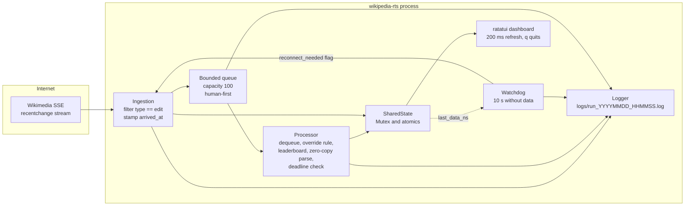
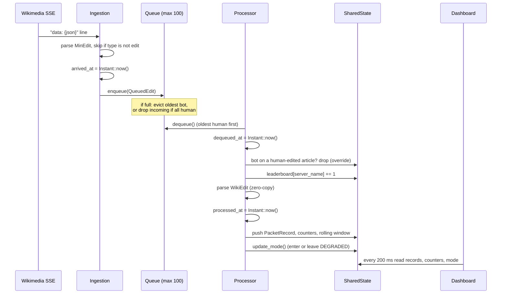
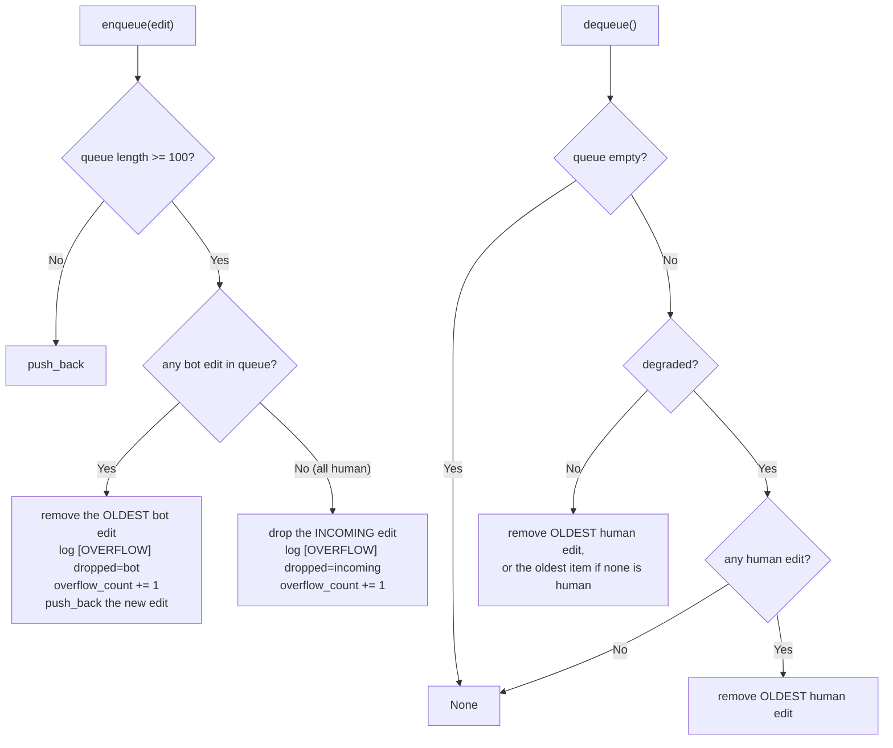
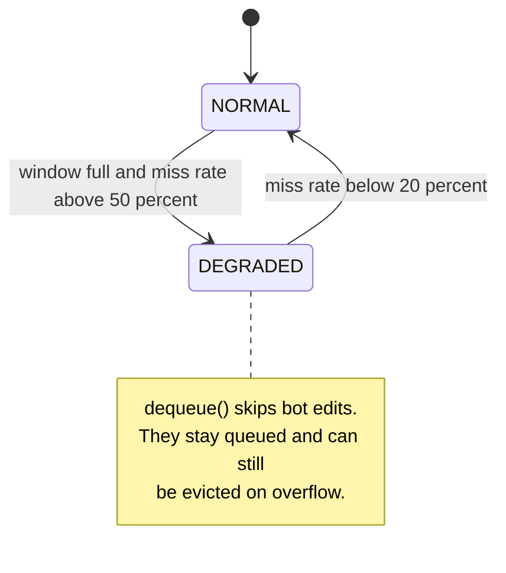
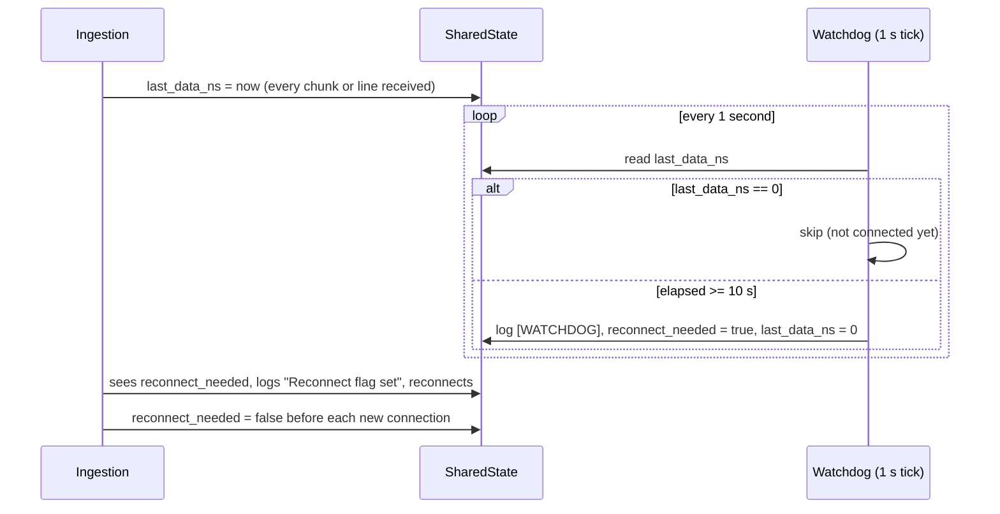
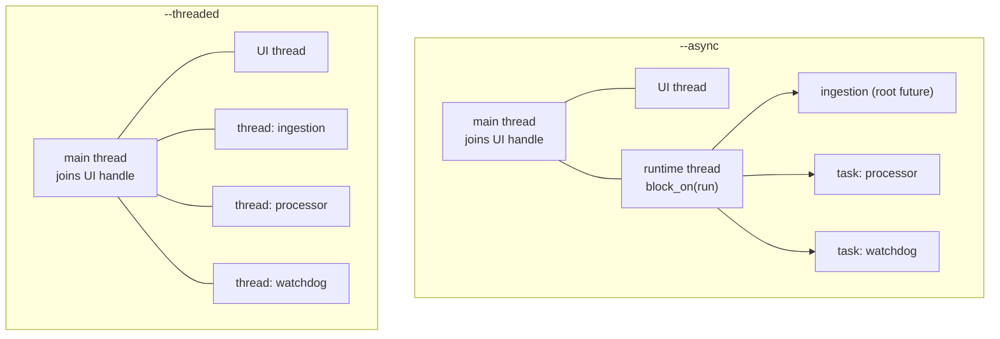

# Real-Time Monitoring System for Wikipedia (Rust)

A **soft real-time edit monitor** for Wikipedia, written in Rust. It connects to the public Wikimedia `recentchange` Server-Sent Events (SSE) stream, keeps only `edit` events, and pushes each one through a bounded priority queue and a processing stage that measures how long every edit waited and whether it was handled within a **2 ms deadline**. Human edits are served before bot edits, and when too many deadlines are missed the system switches itself into a **degraded mode** that skips bot edits until it recovers. A **watchdog** reconnects the stream if no data arrives for 10 seconds, and a **ratatui terminal dashboard** shows everything live.

The same pipeline is implemented twice, once with **Tokio async tasks** and once with **plain OS threads**, so the two concurrency models can be compared with live runs and with Criterion benchmarks. The project looks like coursework for a real-time systems module (the benchmark comments mention a "distinction-level requirement" and the HTTP user agent is `wikipedia-rts/0.1 (student project)`).

> Detailed source guide, preserved from the previous README. Fresh local verification on 17 October 2026 is recorded in [VERIFICATION.md](VERIFICATION.md); the old expected command labels below describe the original documentation pass. Committed May logs are historical evidence, not a new live run.

---

## Table of contents

1. [What it does](#what-it-does)
2. [Architecture](#architecture)
3. [How one edit travels](#how-one-edit-travels)
4. [Scheduling policy: queue, priority and overflow](#scheduling-policy-queue-priority-and-overflow)
5. [Degraded mode and watchdog](#degraded-mode-and-watchdog)
6. [Concurrency model](#concurrency-model)
7. [Command-line interface](#command-line-interface)
8. [Project structure](#project-structure)
9. [Setup and run](#setup-and-run)
10. [Dashboard](#dashboard)
11. [Log files](#log-files)
12. [Observed results in the committed logs](#observed-results-in-the-committed-logs)
13. [Tests and benchmarks](#tests-and-benchmarks)
14. [Code walkthrough](#code-walkthrough)
15. [Configuration reference](#configuration-reference)
16. [Troubleshooting](#troubleshooting)
17. [Repository hygiene notes](#repository-hygiene-notes)
18. [Limitations and next steps](#limitations-and-next-steps)

---

## What it does

- Streams live edits from `https://stream.wikimedia.org/v2/stream/recentchange` and ignores every event whose `type` is not `edit` (log actions, categorisation, new pages and so on).
- Classifies each edit as **human** or **bot** from the event's `bot` field (a missing field counts as human).
- Queues edits in a **bounded queue of 100** and always dequeues the oldest **human** edit first.
- Stamps three timestamps per edit (arrived, dequeued, processed) and checks the total against a **2 ms deadline**.
- Keeps a **rolling window of the last 20 results**: more than 50 % misses puts the system in **DEGRADED** mode (bot edits are skipped), fewer than 20 % misses returns it to **NORMAL**.
- Drops a bot edit when the last edit to the same article was made by a human (the "override" rule).
- Keeps a live **top-3 leaderboard** of wiki domains by edit count.
- Reconnects automatically on errors, stream end, or 10 s of silence (watchdog).
- Shows a live terminal dashboard and writes a per-run log file under `logs/`.
- Includes a tracking global allocator and a `--heap-proof` mode that compares heap allocations of zero-copy and owned JSON parsing.

| Technology | Role |
|---|---|
| Rust (edition 2021) | Language |
| Tokio 1 (`full` features) | Async runtime for the async pipeline |
| `std::thread` | OS-thread version of the pipeline, watchdog and dashboard thread |
| reqwest 0.12 (`blocking`, `stream`) | HTTP client: async streaming for `--async`, blocking for `--threaded` and `--capture` |
| futures-util 0.3 | `StreamExt::next` over the async byte stream |
| serde 1 + serde_json 1 | JSON parsing, including zero-copy borrowed `&str` fields |
| chrono 0.4 | Local timestamps for log file names and overflow lines |
| ratatui 0.26 + crossterm 0.27 | Terminal dashboard and raw-mode keyboard input |
| criterion 0.5 (`html_reports`, dev-dependency) | Benchmarks (`harness = false`) |

Resolved versions in the committed `Cargo.lock` (lock format version 4, 244 packages): tokio 1.50.0, reqwest 0.12.28, serde 1.0.228, serde_json 1.0.149, futures-util 0.3.32, chrono 0.4.44, ratatui 0.26.3, crossterm 0.27.0, criterion 0.5.1.

---

## Architecture



Everything the stages share lives in one `SharedState` (`src/state.rs`) wrapped in an `Arc`. Structures that need multi-field consistency use a `Mutex`; simple counters and flags use atomics.

---

## How one edit travels



Three timestamps per edit define every number the system reports:

| Quantity | Formula | Meaning |
|---|---|---|
| `drift_ms` | `dequeued_at - arrived_at` | Time spent waiting in the queue |
| `exec_ms` | `processed_at - dequeued_at` | Time spent processing |
| `total_ms` | `processed_at - arrived_at` | Compared with the deadline |
| deadline met | `total_ms < 2.0` | Strictly less than 2 ms |

---

## Scheduling policy: queue, priority and overflow



Implemented in `src/queue.rs` (a `VecDeque` behind a `Mutex`). Consequences you can see in the logs:

- Priority is **human first, FIFO inside each class**. Bots only run when no human edit is waiting.
- Bots therefore **starve** under load: bot queue wait is around 12 to 14 seconds at the median in every committed run (see [Observed results](#observed-results-in-the-committed-logs)).
- Bot edits are the shock absorber: every `[OVERFLOW]` line in the committed logs is `dropped=bot`; no `dropped=incoming` line appears in any of the seven logs.

---

## Degraded mode and watchdog



`SharedState::update_mode` (`src/state.rs`) runs after every processed edit. It does nothing until the rolling window holds 20 results. The two thresholds (50 % to enter, 20 % to leave) form a hysteresis band so the mode does not flip on every edit.



The watchdog never kills anything; it only raises a flag that the ingestion loop checks before reading the next chunk (async) or the next line (threaded). In the dashboard the mode bar shows `WATCHDOG - reconnecting...` while the flag is set, which takes priority over `DEGRADED`.

---

## Concurrency model

| | `--async` | `--threaded` |
|---|---|---|
| Entry function | `run_async()` in `main.rs` | `run_threaded()` in `main.rs` |
| Runtime | One `std::thread` that owns a Tokio multi-thread runtime and calls `block_on(async_pipe::run(..))` | No runtime |
| Ingestion | The root future of `block_on`; `reqwest::Client` with `bytes_stream()`; characters are accumulated into lines manually | A spawned thread; `reqwest::blocking::Client` (connect timeout 10 s, request timeout 3 s) read through `BufReader::lines()` |
| Processor | `tokio::spawn` task; sleeps 1 ms with `tokio::time::sleep` when the queue is empty | Spawned thread; `std::thread::sleep(1 ms)` when empty |
| Watchdog | Inline `tokio::spawn` task in `async_pipe.rs` | `watchdog::start` spawns a thread (`src/watchdog.rs`) |
| Dashboard | `ui::start` spawns a thread | `ui::start` spawns a thread |
| Shared code | `pipeline::process_edit`, `queue`, `state`, `leaderboard`, `metrics`, `logger` | same |

Both modes share a single `process_edit` function, so any difference in the results comes from scheduling and I/O, not from the processing logic. The main thread joins the dashboard thread; when you press `q` it flushes the log, prints the percentile summary, and the process exits, which stops all background threads and tasks (none of them has a shutdown path of its own).



Synchronisation choices (explained in comments in `state.rs`): `Mutex` for the queue, leaderboard, last-editor map, record list and rolling window; `AtomicBool` and `AtomicU64` with `Ordering::Relaxed` for flags and counters. `benches/bench.rs` includes a Mutex versus RwLock versus Atomic contention benchmark to justify that split.

---

## Command-line interface

The binary is `wikipedia-rts` (package name in `Cargo.toml`); the library crate is `wikipedia_rts`. Arguments are parsed by hand from `std::env::args()` in `src/main.rs`; only the first argument is inspected.

| Argument | Effect |
|---|---|
| `--async` | Run the Tokio pipeline with the dashboard |
| `--threaded` | Run the OS-thread pipeline with the dashboard |
| `--capture <N>` | Save `N` raw `edit` events to `test_data/events.jsonl` and exit. `N` defaults to 500 if missing or not a number |
| `--heap-proof` | Parse one sample JSON line 10,000 times as zero-copy and as owned, print allocation counts, exit |
| *(none)* | Prints `Usage: wikipedia-rts --async | --threaded | --capture <N> | --heap-proof` and exits with status 1 |
| *(anything else)* | Prints `Unknown argument: ...` and exits with status 1 |

---

## Project structure

```
rts_monitoring_system_for_wikipedia/
├── Cargo.toml              # package wikipedia-rts 0.1.0, edition 2021, deps and the bench target
├── Cargo.lock              # committed, lock format v4
├── .gitignore              # only "/target"
├── src/
│   ├── main.rs             # CLI entry: --async, --threaded, --capture, --heap-proof
│   ├── lib.rs              # module list + #[global_allocator] = TrackingAllocator
│   ├── allocator.rs        # counting wrapper around the System allocator
│   ├── model.rs            # MinEdit, WikiEdit<'a> (zero-copy), WikiEditOwned
│   ├── state.rs            # SharedState, constants, update_mode, push_result
│   ├── queue.rs            # bounded human-first queue: enqueue, dequeue
│   ├── metrics.rs          # PacketRecord, percentile, print_stats
│   ├── leaderboard.rs      # per-domain counters, top3
│   ├── logger.rs           # file / terminal / null logger
│   ├── watchdog.rs         # watchdog thread for the threaded pipeline
│   ├── ui.rs               # ratatui dashboard
│   └── pipeline/
│       ├── mod.rs          # process_edit (shared by both pipelines)
│       ├── async_pipe.rs   # Tokio ingestion, processor and watchdog
│       └── thread_pipe.rs  # OS-thread ingestion and processor
├── tests/
│   └── unit_tests.rs       # 14 unit tests (pure logic, no network)
├── benches/
│   └── bench.rs            # Criterion: sync_contention, parsing, pipeline_comparison
├── test_data/
│   └── events.jsonl        # 500 captured edit events used by the pipeline benchmark (~0.67 MB)
├── data/
│   └── captured_events.jsonl   # 500 raw events of mixed types (~0.73 MB); not read or written by any code
└── logs/
    └── run_20260510_*.log  # 7 run logs from 10 May 2026 (~17 MB in total)
```

---

## Setup and run

### 1. Prerequisites

- A recent stable Rust toolchain with Cargo (the lock file uses format version 4, which needs Cargo 1.78 or newer; the manifest sets no `rust-version`).
- Internet access to `stream.wikimedia.org` for `--async`, `--threaded` and `--capture`.
- A real interactive terminal for the dashboard (it enables raw mode and the alternate screen).

### 2. Build (expected)

```bash
cargo build --release
```

### 3. Run the live monitor (expected)

```bash
cargo run --release -- --async       # Tokio tasks
cargo run --release -- --threaded    # OS threads
```

Press `q` to quit. On exit the program flushes the log and prints two summary lines:

```
human  p50=0.82ms  p90=1.56ms  p99=9.72ms  miss=821/14787
bot    p50=...     p90=...     p99=...     miss=.../...
```

The percentiles are of **drift** (queue wait); `miss=` counts edits whose **total** time exceeded 2 ms. (The numbers above are only an illustration of the format, taken from one committed log.)

Run from the project root: the logger writes to the relative path `logs/` and `--capture` writes to `test_data/`.

### 4. Run the tests (expected)

```bash
cargo test
```

### 5. Run the benchmarks (expected)

```bash
cargo bench                         # all three groups; needs test_data/events.jsonl (already committed)
cargo bench -- sync_contention      # a single group, by Criterion name filter
```

To refresh the replay file with newer events:

```bash
cargo run --release -- --capture 500
```

### 6. Heap-allocation proof (expected)

```bash
cargo run --release -- --heap-proof
```

It prints the allocation count and bytes for 10,000 zero-copy parses versus 10,000 owned parses, followed by allocations per iteration and the percentage reduction. The code is written so that the zero-copy case needs no allocations for an input without escape sequences, but the actual numbers were not measured for this README.

---

## Dashboard

`src/ui.rs` redraws every 200 ms (it polls the keyboard for up to 200 ms, then redraws) using this vertical layout:

| Area | Content |
|---|---|
| Packets table (min 10 rows) | Last 8 processed edits: domain, user, type (HUMAN/BOT), drift, exec, total, deadline (MET in green, MISS in red) |
| Middle left (55 %) | "scheduling drift": human and bot p50 / p90 / p99 of drift in ms, over all records so far |
| Middle right (45 %) | "leaderboard": top 3 domains with counts |
| Mode bar | `mode: NORMAL` (green), `mode: DEGRADED (bot edits skipped)` (red), or `mode: WATCHDOG - reconnecting...` (yellow) |
| Counters bar | `processed`, `missed`, `overflow`, `override`, `resets` (number of connections made, including the first) |

Only the `q` key is handled. If the terminal cannot be initialised, the dashboard thread exits silently, which also ends the program (the main thread is waiting on that thread).

---

## Log files

Every run of `--async` or `--threaded` creates `logs/run_YYYYMMDD_HHMMSS.log` (local time) via `Logger::new()`, buffered through a `BufWriter` and flushed on exit. Line formats:

| Prefix | Written by | Example (titles replaced by placeholders) |
|---|---|---|
| `[HUMAN]` / `[BOT  ]` | `process_edit` | `[HUMAN]    en.wikipedia.org \| drift=0.33ms \| exec=0.04ms \| total=0.37ms \| DEADLINE MET` |
| `[OVERFLOW]` | `queue::enqueue` | `[OVERFLOW]  ts=20:39:09.779  dropped=bot  title=<page title>  queue=100/100` |
| `[OVERRIDE]` | `process_edit` | `[OVERRIDE]  Bot dropped (doc last human-edited) \| title=<page title>` |
| `[DEGRADED]` | `update_mode` | `[DEGRADED]  miss_rate=55% > 50% \| Mode: DEGRADED (bot edits skipped)` |
| `[RECOVER]` | `update_mode` | `[RECOVER]   miss_rate=15% < 20% \| Mode: NORMAL` |
| `[WATCHDOG]` | watchdog | `[WATCHDOG]  No data for 10s \| Action: RECONNECT` |
| `[INGEST]` | ingestion | `Connecting...`, `Connection error: ...`, `Stream error: ...`, `Read error: ...`, `Reconnect flag set - reconnecting...` |

The first line of a log tells you which pipeline produced it: `Connecting to Wikipedia SSE stream...` (async) or `Connecting to Wikipedia SSE stream (threaded)...` (threaded).

`Logger` has three modes: file only (`new`, used by both pipelines), file plus terminal (`with_terminal`, not used by `main.rs`), and a null logger (used by tests and benchmarks so they do no I/O).

---

## Observed results in the committed logs

Seven logs from 10 May 2026 (about 17.2 MB, roughly 141,000 packet lines) are committed. I parsed them read-only. These are **single runs against a live stream on a shared machine**, so they show behaviour, not a controlled comparison; the Criterion benchmark is the intended like-for-like test, and no Criterion output is committed.

| Log (`run_20260510_...`) | Pipeline | Human edits | Human missed | Human drift p50 / p99 (ms) | Bot edits | Bot missed | Bot drift p50 (ms) |
|---|---|---|---|---|---|---|---|
| `201120` | async | 14,787 | 821 (5.6 %) | 0.82 / 9.72 | 8,624 | 7,912 (91.7 %) | 12,444 |
| `204101` | async | 14,318 | 7,154 (50.0 %) | 1.90 / 15.94 | 258 | 252 | 13,785 |
| `204104` | threaded | 14,353 | 1,281 (8.9 %) | 0.84 / 15.75 | 7,597 | 6,899 (90.8 %) | 12,131 |
| `211738` | async | 31,231 | 3,490 (11.2 %) | 0.88 / 16.59 | 15,766 | 15,061 (95.5 %) | 12,761 |
| `222714` | async | 10,982 | 5,749 (52.3 %) | 2.06 / 15.84 | 162 | 160 | 14,284 |
| `222805` | threaded | 10,593 | 552 (5.2 %) | 0.85 / 9.46 | 6,378 | 5,564 (87.2 %) | 12,473 |
| `225435` | async | 4,668 | 1,196 (25.6 %) | 1.11 / 17.68 | 1,499 | 1,496 (99.8 %) | 13,390 |

What the logs show:

- Median human drift is about 1 ms in the good runs, and processing itself is cheap (exec p99 is below 1 ms in every run). Almost all of the 2 ms budget is spent waiting in the queue, not working.
- Bot edits **practically always miss** the deadline (median queue wait of 12 to 14 seconds) because human edits always go first. This is a direct result of the strict priority rule, not of slow processing.
- Two async runs (`204101` and `222714`) processed very few bot edits (258 and 162), had far more overflow events (9,838 and 7,808) and about half of the human edits missed the deadline. The logs do not record why (machine load or network behaviour are both possible), so treat these as unexplained.
- Event totals across all seven logs: 32,313 `[OVERFLOW]`, 534 `[OVERRIDE]`, 3,477 `[DEGRADED]` and 3,463 `[RECOVER]` lines, 3 `[WATCHDOG]` lines and 63 `[INGEST]` lines. Individual runs flip between NORMAL and DEGRADED hundreds of times (for example one log has 728 `[DEGRADED]` and 726 `[RECOVER]` lines, another has 1,403 and 1,401). A plausible reason (inference, not measured) is that bot edits left queued during DEGRADED mode have a very large drift when they are processed again, so they count as misses and push the window back towards degraded.
- `[INGEST]` lines show `Connection error` (14 in total), `Read error` (8) and `Stream error` (4) entries. The async log `204101` and the threaded log `204104` each contain a burst of consecutive connection errors near the end of the run (and 3 watchdog reconnects in total), which is consistent with a short network drop; the pipelines kept running afterwards.

---

## Tests and benchmarks

### Unit tests: `tests/unit_tests.rs` (14 tests)

| Area | Tests |
|---|---|
| Deadline arithmetic | within 2 ms passes; over 2 ms fails; bot with 3 ms drift misses; human with low drift meets |
| `percentile` | basic p0 / p50 / p100 on `[1..5]`; empty input returns 0.0 |
| `MinEdit` classification | `bot: true` is not human; missing `bot` defaults to human |
| Queue | human dequeued before an earlier bot; overflow evicts the bot, never a human, and keeps length at capacity; degraded mode skips bots |
| Mode transitions | 20 misses enter DEGRADED; 20 hits recover from DEGRADED |
| Leaderboard | `top3` returns three entries in descending order |

Not covered by tests: `process_edit` (including the override rule), the pipelines, the watchdog, the UI, `Logger`, the allocator, and the "only bots queued while degraded returns `None`" case (the test comment mentions it, but the test only checks that a human is returned).

### Benchmarks: `benches/bench.rs` (Criterion, `harness = false`)

| Group | What it measures |
|---|---|
| `sync_contention` | 16 threads each doing 1,000 increments on a `Mutex<u64>`, an `RwLock<u64>` (write lock) and an `AtomicU64` |
| `parsing` | `WikiEdit<'_>` (zero-copy) versus `WikiEditOwned` (allocating) on one JSON line |
| `pipeline_comparison` | 50 edits from `test_data/events.jsonl` per iteration, each handled by `process_edit` in its own Tokio task (`async`) or its own OS thread (`threaded`); sample size 50. After Criterion finishes it prints per-packet p50 / p90 / p99 in microseconds for both. Panics with a clear message if `test_data/events.jsonl` is missing |

Note that `pipeline_comparison` measures the cost of spawning and running 50 tasks or threads that call `process_edit`; it does not go through the queue, the SSE parsing or the processor loop, so it complements rather than replaces the live runs.

---

## Code walkthrough

### `src/main.rs`

Dispatches on `args[1]`. `run_async` and `run_threaded` create the `SharedState` and `Logger`, start the dashboard, start the pipeline, then block on the dashboard's `JoinHandle`. After `q`, they call `log.flush()` and `metrics::print_stats`. `run_capture` uses the blocking reqwest client to read the stream line by line, keeps only `data: {...}` lines whose JSON has `"type":"edit"`, writes them to `test_data/events.jsonl`, and prints progress every 50 events. `run_heap_proof` is described below.

### `src/model.rs`

```rust
#[derive(Deserialize)]
pub struct MinEdit {                    // parsed at ingestion, owns its Strings
    #[serde(rename = "type")] pub event_type: Option<String>,
    pub bot: Option<bool>, pub title: Option<String>,
    pub server_name: Option<String>, pub user: Option<String>,
}

#[derive(Debug, Deserialize)]
pub struct WikiEdit<'a> {               // hot path, borrows from the raw buffer
    #[serde(borrow)] pub user: Option<&'a str>,
    pub bot: Option<bool>,
    #[serde(borrow)] pub server_name: Option<&'a str>,
    #[serde(borrow)] pub title: Option<&'a str>,
}
```

`WikiEditOwned` has the same fields as `String`s and exists only for comparison in benchmarks and `--heap-proof`. `MinEdit::is_edit()` checks `type == "edit"`; `is_human()` is `!bot.unwrap_or(false)`.

### `src/state.rs`

Constants (`QUEUE_CAPACITY` 100, `DEGRADE_THRESHOLD` 0.50, `RECOVERY_THRESHOLD` 0.20, `WATCHDOG_TIMEOUT_S` 10, `ROLLING_WINDOW_SIZE` 20) and the `SharedState` struct:

| Field | Type | Used for |
|---|---|---|
| `queue` | `Mutex<VecDeque<QueuedEdit>>` | Pending edits |
| `leaderboard` | `Mutex<HashMap<String, u64>>` | Edits per domain |
| `last_doc_editor` | `Mutex<HashMap<String, bool>>` | Was the last edit of this title human? |
| `records` | `Mutex<Vec<PacketRecord>>` | Every processed edit, for the dashboard and final statistics |
| `recent_results` | `Mutex<VecDeque<bool>>` | Rolling window of deadline results |
| `degraded`, `reconnect_needed` | `AtomicBool` | Mode flag, watchdog request |
| `last_data_ns` | `AtomicU64` | Nanoseconds since the Unix epoch of the last received data |
| `total_processed`, `total_missed`, `overflow_count`, `override_count`, `reset_count` | `AtomicU64` | Dashboard counters |

`push_result` appends to the window (capped at 20) and `update_mode` applies the two thresholds, logging `[DEGRADED]` or `[RECOVER]` on a change.

### `src/queue.rs`

`enqueue` and `dequeue` implement the policy in [the diagram above](#scheduling-policy-queue-priority-and-overflow). Both scan the queue with `iter().position(..)`, which is O(n) with n at most 100.

### `src/pipeline/mod.rs`: `process_edit`

The one function shared by both pipelines. In order:

1. **Override rule.** Under the `last_doc_editor` lock: if the edit is a bot edit and the last edit of that title was human, count an override, log it and return `None`. Otherwise record whether this edit was human.
2. `leaderboard::update` for the domain.
3. Zero-copy parse into `WikiEdit` (the parsed value is only used to prove the line is valid JSON; a parse failure returns `None`).
4. Take `processed_at`, build a `PacketRecord`, log the `[HUMAN]` or `[BOT  ]` line with the three timings and `DEADLINE MET` or `DEADLINE MISS`.
5. Update `total_processed`, `total_missed`, the rolling window and the `records` vector.

### `src/pipeline/async_pipe.rs`

`run` clones the shared handles for each task, spawns the **watchdog** task and the **processor** task, and then runs the **ingestion loop** itself. The ingestion loop is an outer reconnect loop around an inner chunk loop:

- Clears `reconnect_needed`, logs `Connecting...`, sends the request with `Accept: text/event-stream`, `Cache-Control: no-cache` and the project user agent. On a connection error it sleeps 3 s and retries.
- Increments `reset_count`, then reads `bytes_stream()`. Before every chunk it checks `reconnect_needed`; on a stream error or a clean end it breaks and reconnects.
- Each chunk updates `last_data_ns`, is decoded as UTF-8 (an invalid chunk is skipped) and split into lines character by character. `process_sse_line` ignores blank lines and `event:` lines, requires the `data: ` prefix, parses a `MinEdit`, discards non-edit events and malformed JSON, stamps `arrived_at`, and calls `enqueue`.

### `src/pipeline/thread_pipe.rs`

Same logic with blocking primitives: a blocking client (`connect_timeout` 10 s, `timeout` 3 s), `BufReader::lines()`, and read errors containing "timed out" or "os error 10060" (a Windows timeout code) treated as a cue to loop and re-check the reconnect flag rather than as fatal. `run` starts the watchdog thread, the ingestion thread and the processor thread, and returns immediately.

### `src/watchdog.rs`

A thread that wakes every second, skips while `last_data_ns == 0`, and when 10 s or more have passed since the last data it logs `[WATCHDOG]`, sets `reconnect_needed` and resets `last_data_ns` to 0 so it does not fire again until fresh data arrives. The async pipeline has an equivalent inline task.

### `src/metrics.rs`

`PacketRecord` (three `Instant`s, `is_human`, `domain`, `user`) with `drift_ms`, `exec_ms`, `total_ms`, `deadline_met` (`total < 2.0 ms`). `percentile(data, p)` sorts and returns the element at index `round(p/100 * (n-1))`, or 0.0 for empty input. `print_stats` prints the human and bot lines shown earlier.

### `src/leaderboard.rs`

`update` increments a per-domain counter; `top3` copies the map, sorts by count descending and truncates to 3 (ties are in unspecified order because `HashMap` iteration order is not stable).

### `src/logger.rs`

`Logger` wraps an enum `LogMode { FileOnly, Terminal, Null }`, each file mode holding a `Mutex<BufWriter<File>>`. File names come from `chrono::Local::now()`. `Drop` flushes. All writes ignore I/O errors (`.ok()`); `new()` panics if `logs/` cannot be created.

### `src/allocator.rs` and `--heap-proof`

`TrackingAllocator` implements `GlobalAlloc` by delegating to `System` and incrementing two `AtomicU64` counters (number of allocations and bytes; `realloc` counts as one allocation and adds only growth). `lib.rs` installs it with `#[global_allocator]`, so it is active in **every** run, not only `--heap-proof`. `allocator::snapshot()` returns `(count, bytes)`; `run_heap_proof` takes snapshots around 10,000 zero-copy parses and 10,000 owned parses of a fixed sample line and prints the difference.

### `src/ui.rs`

Described in [Dashboard](#dashboard). Rendering takes short locks on `records` and `leaderboard`; the drift panel recomputes percentiles over all records on every frame.

---

## Configuration reference

All settings are compile-time constants; there are no config files, environment variables or flags other than the four CLI modes.

| Constant | Where | Value | Effect |
|---|---|---|---|
| `QUEUE_CAPACITY` | `state.rs` | 100 | Maximum queued edits before the overflow policy applies |
| `DEGRADE_THRESHOLD` | `state.rs` | 0.50 | Miss rate above which DEGRADED starts |
| `RECOVERY_THRESHOLD` | `state.rs` | 0.20 | Miss rate below which NORMAL resumes |
| `ROLLING_WINDOW_SIZE` | `state.rs` | 20 | Results considered by `update_mode` |
| `WATCHDOG_TIMEOUT_S` | `state.rs` | 10 | Seconds of silence before a reconnect is requested |
| Deadline | `metrics.rs` (`deadline_met`) | 2.0 ms | Hard-coded literal in `total_ms() < 2.0` |
| `SSE_URL` | `async_pipe.rs`, `thread_pipe.rs` | Wikimedia `recentchange` | Duplicated in both files and in `main.rs` |
| Reconnect back-off | both pipelines | 3 s | Pause after a connection error |
| Threaded client timeouts | `thread_pipe.rs` | connect 10 s, request 3 s | Blocking reqwest client |
| Idle sleep | both pipelines | 1 ms | Processor pause when the queue is empty |
| Dashboard refresh | `ui.rs` | 200 ms | Poll interval |

---

## Troubleshooting

| Symptom | What to check |
|---|---|
| Prints the usage line and exits | You passed no argument; use `--async` or `--threaded` (after `--` when using `cargo run`) |
| `Unknown argument` | Only the four modes are accepted, and `--capture` takes its number as the next argument |
| Garbled screen or no dashboard | Run in a real terminal, not an IDE output pane or a pipe; the dashboard needs raw mode |
| Terminal left in raw mode after a crash | Run `reset` (Linux/macOS) or open a new terminal window |
| `[INGEST] Connection error` repeated | No internet, proxy or firewall blocking `stream.wikimedia.org`; the loop retries every 3 s |
| Mode bar shows `WATCHDOG - reconnecting...` | No data for 10 s; normally clears on the next successful connection |
| `Missing test_data/events.jsonl` when benchmarking | Run `cargo run --release -- --capture 500` (the file is committed, so this usually means the wrong working directory) |
| `logs/` appears in a different folder | The logger and `--capture` use paths relative to the current directory; run from the project root |

---

## Repository hygiene notes

- **`logs/` is tracked and should be gitignored.** It holds seven generated files (0.75 to 5.4 MB each, about 17.2 MB in total) and every run adds a new one. New runtime `.log` files are now ignored. The existing historical logs are preserved in the tracked snapshot for the analysis below. Files already pushed stay in the Git history unless the history is rewritten.
- **No secrets were found.** I searched the logs, both `.jsonl` files, the sources and the manifest for passwords, tokens, API keys, bearer strings and e-mail addresses. The only hits were page titles that contain the words "Secretary" and "Token". The code makes unauthenticated requests only.
- **The `.jsonl` files contain real public Wikipedia edit metadata** (editor user names, edit summaries, page titles). It is public data, but consider whether the repository needs all 1,000 lines; a small sample is enough for the benchmark.
- `data/captured_events.jsonl` is **not produced or read** by the current code (`--capture` writes `test_data/events.jsonl`). It contains unfiltered events (177 `edit`, 227 `categorize`, 71 `log`, 25 `new`), so it looks like output from an earlier version of the capture command. Delete it or document it.
- There is no standalone `LICENSE` file. The concise entry page now lives in the repository README.

---

## Limitations and next steps

- **Soft, not hard, real time.** The 2 ms deadline is measured and reported but nothing enforces it; there is no real-time scheduling class, thread priority or core pinning. Results depend on the machine and on the OS scheduler.
- **Bot starvation by design.** The strict human-first rule gives bots queue waits of about 12 to 14 s at the median. Ageing (promote a bot after N ms) or a separate bot lane would bound this.
- **Mode flapping.** Hundreds to over a thousand NORMAL/DEGRADED transitions per run suggest the window of 20 results is short or that stale bot edits distort the miss rate. Candidates: exclude bots from the window, discard stale bot edits instead of processing them late, or use a longer window.
- **Async watchdog cannot interrupt a stalled read.** In `async_pipe.rs` the reconnect flag is only examined between chunks, and the client has no timeout, so `stream.next().await` can wait indefinitely on a silent connection. Wrapping the read in `tokio::time::timeout` would fix this. In `thread_pipe.rs` the 3 s request timeout is documented as a read deadline; whether reqwest's blocking `timeout` applies per read or to the whole response body should be checked against the reqwest docs before relying on it.
- **Possible line corruption in the async reader.** A chunk that is not valid UTF-8 is skipped whole (`Err(_) => continue`). If a multi-byte character (titles in the logs include Cyrillic and CJK text) is split across two network chunks, the chunk is dropped and the next line in `line_buf` is glued to a partial one; the resulting malformed JSON is then discarded silently. The threaded version reads through `BufReader::lines()` and does not have this problem.
- **Unbounded memory.** `records` keeps a `PacketRecord` for every processed edit and `last_doc_editor` keeps one entry per article title for the lifetime of the process.
- **The dashboard can disturb the measurement.** Each frame (every 200 ms) clones and sorts all drift values to compute percentiles while the processor needs the same `records` lock to append; the cost grows with run length.
- **`process_edit` order.** Side effects (override map, leaderboard) happen before the JSON parse, so an edit that fails to parse still updates them. The parsed `WikiEdit` is not used afterwards.
- **Panics on I/O problems.** `Logger::new`, `--capture` and several mutex locks use `unwrap()`; a poisoned mutex or an unwritable `logs/` directory aborts the program.
- **Duplicated code.** The ingestion filtering and the `SSE_URL` constant exist in two pipeline files and in `main.rs`.
- **Wikimedia etiquette.** The user agent is `wikipedia-rts/0.1 (student project)`; Wikimedia's User-Agent policy asks for contact information, which is worth adding if the tool is run regularly.
- **Test and CI gaps.** No tests for `process_edit`, the override rule, the pipelines or the watchdog; no CI configuration; no recorded Criterion results.
- Ideas: persist records to a bounded ring buffer or a file, expose metrics over HTTP (Prometheus format), make the thresholds configurable via CLI flags, add a replay mode that feeds `test_data/events.jsonl` through the real queue and processor for repeatable pipeline comparisons.
